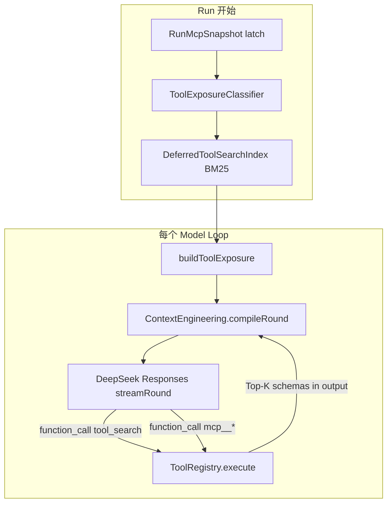

# K5 Context Engineering

> 状态：**K5-A 已完成**（`skills` / `memories` 候选字段与 CE 注入）；**K5-B 已完成**（§10 MVP：Tool Exposure + Host `tool_search`）；**当前实施重点**为统一多来源预算与 Context trace（§7 **K5-C**）。Skills / Memory 业务见 [40-c6-skills.md](./40-c6-skills.md)、[41-c7-user-memory.md](./41-c7-user-memory.md)。
>
> K5 的目标是让不同 Context 来源经过统一的选择、预算、渲染、压缩和调试流程，再进入模型请求。K5 不负责产生 Skill 或 Memory 业务事实。

## 1. 当前基础

现有 `ContextCompileInput` 已统一接收：

- `messages`
- `tools`
- `mcpInstructions`
- `compactionState`
- `model` / `sessionId`
- `signal`

Context 编译已经支持模型输入 token 估算、Tool Result 裁剪、封闭历史前缀压缩、压缩状态持久化、最终预算保护和 Context 调试快照。

## 2. C6 接入的最小接口

在现有 `ContextCompileInput` 上增加两个明确的候选来源字段：

```ts
type ContextCompileInput = {
  sessionId: string;
  model: string;
  messages: ModelMessage[];
  tools?: AgentToolDefinition[];
  signal?: AbortSignal;
  compactionState?: CompactionState;
  mcpInstructions?: ReadonlyArray<McpServerInstructionSnapshot>;
  skills?: ReadonlyArray<SkillContextInput>;
  memories?: ReadonlyArray<MemoryContextInput>;
};
```

第一版类型保持分离，不引入通用 Plugin、Provider、Fragment 或 Attention Engine：

```ts
type SkillContextInput = {
  skillId: string;
  version: string;
  content: string;
  priorityHint?: number;
};

type MemoryContextInput = {
  memoryId: string;
  content: string;
  sourceRefs: MemorySourceRef[];
  priorityHint?: number;
};
```

这些字段表示“候选 Context 来源”，不表示一定注入。C6 负责提供合法、可追溯的候选内容；K5 负责决定是否选择、放置、裁剪和压缩。

Skill 和 Memory 的来源语义保持不同：

- Skill 使用 `skillId` 与 `version` 表示能力身份和版本；
- Memory 使用 `memoryId` 与 `sourceRefs` 表示记忆身份和可追溯事实；
- Skill 内容可以作为任务说明，Memory 内容只能作为参考信息，不能绕过 System Prompt 或 Tool Policy。

该接口先作为 API 内部类型放在 `apps/api/src/context-engineering/`，不立即提升到 `packages/agent-protocol`，避免过早冻结公共协议。

## 3. K5 的职责

K5 后续负责：

1. 为 Skills、Memory、MCP、文件、历史消息和 Tool Result 统一估算预算；
2. 根据任务相关性、来源类型和优先级选择候选内容；
3. 将 Skill 与 Memory 渲染到稳定、可识别的 Context 区块；
4. 处理来源之间的保留、裁剪、摘要和显式展开；
5. 记录 selected / dropped / truncated 的 Context trace；
6. 大 catalog **Tool Exposure** 与 Host **`tool_search`**（设计见 §6）；
7. 在真实多来源 Context 形成后，再评估 Goal Reminder / Attention Refresh。

## 4. 明确不做

当前不在 K5 接口中加入：

- 任意来源直接返回 `ModelMessage[]`；
- 来源自行指定 `system/user/assistant` 角色或插入位置；
- 通用插件热加载和 Marketplace；
- 把 Memory 全文默认注入每一轮；
- 用 `priorityHint` 代替权限和数据归属校验；
- 在没有真实数据前冻结复杂的通用相关性引擎。

## 5. 实施顺序（总览）

```text
K5-A  冻结 skills / memories 候选字段，并保持当前编译结果兼容     [已完成]
  -> C6 提供 Skill 候选；C7 提供 Memory 候选
K5-B  Tool Exposure + Host tool_search（对齐 Codex App-Server）   [已完成，以 §10 MVP 为准]
K5-C  统一多来源预算、裁剪仲裁、Context trace                      [当前]
K5-D  Attention Refresh / Goal Reminder（有真实 trace 后再做）
```

§6–§8 为 **K5-B / K5-C** 的主设计；**§9** 为辩证评审；**§10** 为 MVP **冻结边界**（实现以 §10 为准，与 §6 冲突时 §10 优先）。实现以 Harness 代码与 DeepSeek [Responses API](https://api-docs.deepseek.com/guides/responses_api/) 为准。

---

## 6. Tool Exposure 与 tool_search（对齐 Codex App-Server）

### 6.0 目标与非目标

**目标**

- **行为**对齐 Codex App-Server：MCP 在 Run 内 **全量 latch**，请求模型时 **少暴露**；大面工具 **Deferred**；模型按需调用 **`tool_search`**；Host **BM25** 检索；再 **`function_call`** 真实 MCP 工具。
- **协议**适配 **DeepSeek Responses**：全程仅 `function` / `function_call` / `function_call_output`。DeepSeek 对 OpenAI 内置 `web_search` / `file_search` / 非 `function` 工具类型 **静默忽略**，因此 **不能**依赖 OpenAI Codex 的原生 `tool_search` 工具类型或 Deferred 的 wire 形态。
- **工程**对齐现有 Harness：`RunMcpSnapshot`、`ToolRegistry` 分派、`ContextEngineeringService.compileRound`、Agent Runtime 每 loop 组装 `definitions`。

**非目标（首期）**

- Cordis 插件、Apps/OAuth、MCP elicitation、OpenAI `mcp` built-in tool 类型。
- 向量语义检索（BM25 与 Codex 一致即可）。
- 改动 MCP 连接、审批、超时语义（沿用 `McpToolExecutor`）。

### 6.1 与 Codex 的对齐关系

| 维度 | Codex App-Server | Harness（本设计） |
|------|------------------|-------------------|
| MCP 注册 | 连接后全量 list，Session 内可见 | Run latch 全量 `RunMcpSnapshot.entries` |
| 每轮 `tools[]` | Direct 子集 + 条件性 `tool_search` | 同 |
| 大 MCP | **Deferred**，不进 `tools[]` | 同：`exposure: 'deferred'` |
| 检索 | Host BM25，Top-K ≈ 8 | Run 级内存索引，默认 K=8 |
| Schema 写回对话 | Responses **原生** tool search 输出项 | **`function_call_output` JSON** 携带完整工具定义 |
| 「模型支持 search」 | 模型目录 `supports_search_tool` | **无供应商开关**：`deferredCount > 0` 且未禁用时注入 `tool_search` |
| Skills / Memory | 进入 CE 块 | 已有 `<skills>` / `<user_memory>`，纳入统一 token 预算（§7） |
| 每 model loop | 重算暴露集 | `buildToolExposure(run, loop)` |

**结论**：Codex 的 Deferred + Host 索引 + 内置 search **行为**照搬；**写回 schema** 改为 DeepSeek 支持的 **Host 内置 `function` 工具 + tool result**。

### 6.2 现状基线（代码）

- **暴露**：`ToolRegistry.definitions()` = 静态 Agent 工具 + `McpToolCatalogService.definitionsForRun` **全量 MCP**（standing context 最大头）。
- **CE**：Skills / Memory / MCP instructions 已注入；`estimate(messages, tools)` **含整包 tool JSON**。
- **Runtime**：每 loop 合并 registry definitions 与 `builtinToolDefinitions()`，再 `compileRound` → `streamRound`（`api: 'responses'` 时走 DeepSeek Responses）。

改造焦点：**组 `definitions` 的策略**、**执行 `tool_search`**；CE 增加预算分项，不破坏 transcript 校验主线。

### 6.3 总体架构



**建议新增模块**

1. **`ToolExposureService`**：Direct / Deferred 划分、每轮 `tools[]`、Run 内 **Activated** 集合。
2. **`ToolSearchIndex`**：对 deferred 条目建 BM25；响应 `tool_search` 查询。
3. **`ToolSearchTool`**（内置 `AgentTool`）：对外工具名 **`tool_search`**（`type: function`）。

### 6.4 暴露三档：Direct / Deferred / Activated

#### Direct（每轮进入 `tools[]`）

- Harness 调查 / 交付工具（现有 catalog；`filterToolDefinitionsForPhase` 仍生效）。
- Runtime builtin（如 `update_plan`）。
- MCP **资源门面**：`list_mcp_resources` / `read_mcp_resource` 等（schema 小）。
- **显式 Direct 的 MCP**：`enabledTools` 白名单内的工具（即使全局 deferred 开启也 Direct）。
- **本 Run 已被 `tool_search` 激活的 MCP**（见 Activated）。

#### Deferred（仅进 BM25 索引，默认不进 `tools[]`）

默认策略（可 env 覆盖）满足任一即 deferred：

- MCP 工具且 **不在** Direct 白名单；
- 或 MCP 总数 **> `MCP_DIRECT_CAP`**（建议默认 `0`：全部 MCP deferred，最省 standing tokens）；
- 或 MCP definitions 预估 tokens **> `MCP_STANDING_BUDGET`**。

Latch 时为每个 `McpToolCatalogEntry` 打标 `exposure: 'direct' | 'deferred'`（挂在 Run 快照或等价结构；catalog generation 变更只影响新 Run）。

#### Activated（Run 内已 materialize）

1. 模型调用 **`tool_search`** → Host 返回 Top-K 的 `{ name, description, parameters }`。
2. 将 K 个 **`publicName` 写入 `activatedTools`**（挂在 `ActiveRun`，Run 结束失效）。
3. 后续 loop：**Activated 升格为 Direct**（进入 `tools[]`），避免重复 search；仍受 delivery phase 与 presentation 分类约束。

### 6.5 内置 `tool_search`（Host 实现）

#### 注入条件

与 Codex「有 deferred 才提供 search」一致：

```text
deferredCount > 0
&& toolPhase !== 'final_only'
&& TOOL_SEARCH_ENABLED !== false
```

条件满足时 **`tool_search` 每 loop 出现在 `tools[]`**（模型决定是否调用；Host 不自动 search）。

#### 工具声明（Responses `function`）

```json
{
  "name": "tool_search",
  "description": "Search deferred MCP tools by natural language. Returns matching tool definitions (name, description, parameters). Call a returned tool by its exact name in a follow-up function_call.",
  "parameters": {
    "type": "object",
    "properties": {
      "query": {
        "type": "string",
        "description": "What capability you need, e.g. 'create calendar event' or 'query database'."
      },
      "limit": { "type": "integer", "minimum": 1, "maximum": 16, "default": 8 }
    },
    "required": ["query"],
    "additionalProperties": false
  }
}
```

- **执行策略**：`auto_execute`；不计入 delivery tool turn（类比 `update_plan`）。

#### 执行逻辑

1. 对 Run 的 `DeferredToolSearchIndex` 做 **BM25（English）**。
2. **索引文本** = `publicName` + `serverName` + `rawName` + `description` + 参数字段名（**不**索引整段 JSON schema，与 Codex 一致）。
3. Top-K 从 **`mcpSnapshot.entries`** 取完整 `parameters`。
4. 返回固定 envelope 的 JSON 字符串，例如：

```json
{
  "tools": [
    { "name": "mcp__github__create_issue", "description": "...", "parameters": { } }
  ],
  "hint": "Use function_call with the exact name field."
}
```

5. 结果长度受 CE **tool result 轮次预算**约束；超长则减小 K 或截断 description（优先保留 `name` + `parameters`）。

#### 安全

- 只返回当前 Run latch 内的 deferred 工具。
- **`tool_search` 不 bypass 审批**；后续 MCP call 仍走 `defaultApproval`。

### 6.6 BM25 索引生命周期

| 事件 | 动作 |
|------|------|
| Run latch 完成 | 对 snapshot 中所有 `deferred` 建内存索引 |
| Run 进行中 | 索引只读；`activatedTools` 可增 |
| Catalog generation 变化 | 不影响进行中 Run |
| `deferredCount === 0` | 不建索引、不注入 `tool_search` |

### 6.7 Runtime / Registry 改造要点

**替换全量 MCP definitions**

```text
definitions(ctx) =
  staticAgentTools(filteredByPhase)
  + mcpDirectAndActivated(ctx)
  + (shouldInjectToolSearch ? [tool_search] : [])
```

`mcpDirectAndActivated` = snapshot 中 `exposure === 'direct'` ∪ `activatedTools`。

**执行与门禁**

- `tool_search` → `ToolSearchTool.execute`（非 MCP）。
- `mcp__*` → 现有 `McpToolExecutor`。
- **Strict activation gate**：若工具既非 Direct 又不在 `activatedTools`，拒绝执行并提示先 `tool_search`（DeepSeek 无供应商侧 materialization，需 Host 防幻觉工具名）。
- **当轮 activation（实施约束）**：同一 model loop 内，`tool_search` 返回的 Top-K **`publicName` 须立即可执行**（写入 Run 级 `activatedTools` 后再处理同轮后续 `function_call`），避免「结果里已有 schema、gate 仍拒调」的 off-by-one loop。后续 loop 继续保留 Activated → Direct 升格。
- **同批 tool batch（§10.1）**：若 assistant 同一轮声明多个 tool call，Runtime **先执行 `tool_search`，再按原声明顺序**执行其余 call；不引入并行 DAG 调度。

**System 提示（minimal）**

当 `deferredCount > 0` 时增加短 system 段：部分 MCP 未直接列出，需要时用 `tool_search` 查找，再按返回的 `name` 调用。

### 6.8 配置

| 配置 | 默认 | 说明 |
|------|------|------|
| `MCP_TOOL_EXPOSURE_MODE` | **`full`（§10.8）** | 双轨 benchmark 通过后再默认 `deferred_search`；`full` 为安全回滚 |
| `MCP_DIRECT_CAP` | **如 `32`（§10.8）** | MCP 数 **≤ cap** 时全部 Direct；超出部分 deferred。`enabledTools` 白名单内仍 **强制 Direct**。不用 `0` 作为产品默认 |
| `TOOL_SEARCH_DEFAULT_LIMIT` | `8` | 对齐 Codex |
| `TOOL_SEARCH_ENABLED` | `true` | |
| Per-server `enabledTools` | 现有 DB 字段 | 名单内工具 **强制 Direct** |

### 6.9 分阶段交付（K5-B）

| 阶段 | 内容 |
|------|------|
| **B1** | `ToolExposureService` + latch 分类；`MCP_TOOL_EXPOSURE_MODE=full` 兼容；指标 `mcp_tools_direct/deferred`、tool definition tokens |
| **B2** | `ToolSearchTool` + BM25 + `activatedTools` + strict gate + deferred 时 system hint |
| **B3** | Chat Completions 路径复用同一 exposure（若 catalog 仍走 chat） |

**发布约束**：**禁止单独上线「全 deferred 且无 `tool_search`」**（仅 B1、未 B2）。若必须先合 B1，须保留足够 **Direct MCP** 或维持 `MCP_TOOL_EXPOSURE_MODE=full`，直到 B2 可用。

### 6.10 观测与验收

**双轨指标**（避免「standing 降了、总成本反升」的假胜利）：

| 轨道 | 指标 | 用途 |
|------|------|------|
| Standing | 首 loop `tools[]` 估算 tokens | 验证 deferred 是否减掉 catalog 大头 |
| End-to-end | 同 benchmark 的 **总 input tokens**、model loop 数、任务成功率、`tool_search` 调用率与空结果率 | 验证 search tax、重试与漏召 |

- **行为**：`tool_search` →（同轮或下轮）`mcp__*` call → 与 `full` 暴露时结果一致。
- **回归**：`enabledTools`、approval、generation latch、delivery phase、`assertResponsesInputToolChain`。
- **切换默认**：仅当 standing **与** end-to-end 同时不差于 `full`（或明确接受成功率换 context）时，才将 `MCP_TOOL_EXPOSURE_MODE` 默认改为 `deferred_search`。

### 6.11 风险与对策

| 风险 | 对策 |
|------|------|
| 模型不 search 就 hallucinate MCP 名 | system hint + strict gate + 稳定错误码引导 search |
| BM25 中文 query / 中英描述漏召 | system 引导英文 query；后续分词或轻量 embedding；**低分/零结果兜底**（见 §9.3） |
| search 结果过大 | limit + CE tool result budget |
| DeepSeek 无原生 tool search 协议，模型把 result 当「参考文本」 | 明确 JSON envelope + hint；Activated 升格进 `tools[]`；同轮 gate |
| 长 Run 内 Activated 累积，`tools[]` 再次膨胀 | 监控每 loop tool standing；可选 cap activated 数量或 LRU |
| delivery phase 与 transcript 中已 search 出的 schema 认知分裂 | delivery 禁调调查类 MCP 时，definitions 与 **system 说明一致**；必要时 delivery 禁用 `tool_search` |
| 与 C4 `enabledTools` 双层过滤职责不清 | 白名单 = 运营强制 Direct；deferred = 自动省 context；文档与 Settings 文案区分 |

### 6.12 与 Tool phase 的一致性

- **investigation**：deferred + `tool_search` 全开（默认）。
- **delivery**：仅暴露 delivery 允许的工具；若仍注入 `tool_search`，模型可能搜到不可调工具——Prefer **delivery 不注入 `tool_search`**，或 search 仅返回 phase 允许的工具子集。
- **`update_plan`**：仍不计 turn；与 exposure 无关。

---

## 7. 统一 Context 预算（K5-C）

在 `compileRound` 中将输入 token 估算拆桶，**`estimate` 必须使用 exposure 后的 `tools[]`**（否则 deferred 无效）。

| 桶 | 内容 | 策略 |
|----|------|------|
| A. Transcript | messages（含 collapse / compaction） | 已有 |
| B. Tool standing | 当前 loop 的 `tools[]` JSON | Direct + Activated + 条件 `tool_search` |
| C. CE 块 | MCP instructions、skills、memories | 各来源 **cap**（可配置） |
| D. Tool results | 历史 / 当轮 tool output | 已有 round budget |

**超 `promptBudget` 时的仲裁顺序**

1. 收紧 Memory / Skills（按 `priorityHint` 排序裁剪）。
2. 缩短 MCP server instructions。
3. 降低 `MCP_DIRECT_CAP`（更多 deferred）。
4. 已有 aggressive tool result collapse / compaction。

Compaction 触发仍用 `compactionTriggerTokens`；后续 K5-C 补充 **selected / dropped / truncated** 的 Context trace（Workbench Context Tab 消费）。

---

## 8. 与 §2–§4 的关系

- §2 的 `skills` / `memories` **候选字段**不变；K5-C 负责 cap 与 trace，不改变 C6/C7 产生事实的职责边界。
- §4「明确不做」仍然有效；Tool Exposure 不引入通用 Plugin Marketplace。
- MCP 连接与 admin 见 [35-c4-mcp-client.md](./35-c4-mcp-client.md)；本设计只改 **Run 内向模型暴露** 的策略，不改 C4 传输与 latch 语义。

---

## 9. 设计辩证与决策（2026-10-16）

本节记录 §6 方案的权衡、失效条件与合题结论，供评审与默认配置拍板；**不改变 §6 的主设计**。

### 9.1 正题：为何在现约束下合理

- **痛点真实**：Run 内全量 MCP schema 进每轮 `tools[]` 是 standing context 主因；Skills/Memory 块通常次之。
- **约束集**：DeepSeek Responses 仅可靠支持 `function` 工具链；Run **全 latch** 不变；MCP 执行/审批链不变；行为上对齐 Codex App-Server（少暴露、按需 hydrate）。
- **在此约束下**，Deferred + Host `tool_search` + Activated 是少数同时 **省 standing** 与 **保留全 catalog 语义** 的路径；`MCP_TOOL_EXPOSURE_MODE=full` 保留回滚。

### 9.2 反题：不对齐处与方案代价

| 张力 | 说明 |
|------|------|
| Codex 训练/产品 vs 通用模型 | Codex 侧有原生 tool search 与 `supports_search_tool`；DeepSeek 无等价 wire，模型「先 search 再 call」的稳定性 **需 benchmark 验证**，不能假设对齐即有效。 |
| Standing ↓ vs loop ↑ | 用 **多轮 search + tool result** 换首包 schema；总 input tokens 与 loop 数可能上升。 |
| BM25 与业务语言 | 与 Codex 一致用 English BM25 实现简单，但对中文 query、中英混杂 MCP 描述 **漏召** 风险高。 |
| Strict gate | 补 DeepSeek 无 materialization 协议；实现须 **同轮 activation**（§6.7），否则 gate 本身制造失败。 |
| Activated 累积 | 长 Run 探索型任务中 `tools[]` 可能从「全量 MCP」变为「常用子集仍很大」；Compaction 不压 `tools[]`。 |
| 与 C4 `enabledTools` | 运营白名单可止血 token；deferred 是自动层。两层并存时须避免「既不让全暴露又不教 search」的中间态（见 §6.9 发布约束）。 |

### 9.3 备选路线（何时可能优于 §6）

| 路线 | 适用 | 相对 §6 |
|------|------|---------|
| **`full` 全量暴露** | 1M context、MCP 少、短任务 | 实现零增；standing 高 |
| **C4 `enabledTools` 强运营** | 工具集稳定、愿维护白名单 | 无 search tax；配置成本在人 |
| **Lens 式少量 meta tool** | 愿改模型交互为「门面 + Host routing」 | schema 更小；**不依赖**模型学会 search；Host 逻辑更重 |
| **全量 + 更强 compaction** | 暂不想动 Tool Registry | 不解决 standing；仅缓 transcript |

§6 本质是赌 **「standing 贵、tool loop 相对便宜」**；调查型 agent + 大 MCP catalog 更划算；极短问答或 MCP 极少时 **`full` 可能总成本更低**。

### 9.4 合题：实施与默认建议

1. **B1 与 B2**：不得长期存在「全 deferred 无 search」；灰度时保持 `full` 或 partial Direct。
2. **双轨验收**（§6.10）：standing 与 end-to-end 同时看，再改默认 mode。
3. **当轮 activation**（§6.7）：search 与 subsequent call 同 loop 可执行。
4. **`MCP_DIRECT_CAP`**：产品默认倾向 **阈值/白名单 Direct**，慎用全局 `0`，除非明确接受每任务 search。
5. **Search 兜底**：BM25 零结果或低分时，返回 **按 server 分组的 name + 一行描述**（仍无 full parameters），或提示缩小 query；避免「空结果 = 模型认为无工具」。
6. **场景开关**：无供应商 `supports_search_tool` 时，可用 **Run 类型 / feature flag** 选择 `full` vs `deferred_search`（例如 research vs 短对话），不强制一套 exposure 覆盖全部场景。
7. **delivery phase**（§6.12）：避免 definitions 禁止而 transcript 仍展示可调 schema 的分裂。

**一句话**：§6 是在 DeepSeek + 全 latch 约束下的 **权衡解**，不是绝对更优；以 **可回滚、双轨指标、同轮 activation、search 兜底、B1/B2 同发约束** 收口风险。

---

## 10. MVP 边界冻结（2026-10-16）

本节对照 **Codex App-Server / OpenClaw Tool Search** 等常见做法，冻结 **K5-B 最小实现** 的边界抉择。**刻意从简**；未列项视为 **不做**，除非线上证明必须补。

**参考（非 Harness 依赖）**

- Codex：Deferred MCP + 原生 `tool_search` + Host BM25 + Responses materialize。
- [OpenClaw Tool Search](https://docs.openclaw.ai/tools/tool-search)：`tool_search` / `tool_describe` / `tool_call` 三件套、英文 query、空 query 不扫全表、小 catalog 可关 compact。

**我们 MVP 范围**：仅 **单步 `tool_search`（结果含完整 `parameters`）** + Direct/Deferred/Activated；**不做** describe/call 分离、batch multi-query、directory 目录块、instructions deferred、Run 内 relatch、embedding 检索、tool 并行 DAG。

### 10.1 同轮多 tool call（parallel batch）

| 业界 | 冻结 |
|------|------|
| 模型可发并行 call；Host 对依赖 call 常串行或 search 先行 | 保持现有 **按声明顺序串行** 执行整批 tool。**若本批含 `tool_search`，固定最先执行**；写入 `activatedTools` 后再执行同批 MCP call。不区分 read/write 并行层。 |

### 10.2 仅 `tool_search`，无 `tool_describe`

| 业界 | 冻结 |
|------|------|
| Codex 常一次 materialize；OpenClaw 常 search → describe → call | **v1 只有 `tool_search`**，命中项返回 **完整 `name` / `description` / `parameters`**。不增加第二步 describe 工具。 |

### 10.3 Activated 与 standing 膨胀

| 业界 | 冻结 |
|------|------|
| 按需 hydrate；OpenClaw 限制 search 响应字符预算 | Run 内 **`activatedTools` 只增不减**（Run 结束清零）。**v1 不做 LRU**。可选粗 **cap（如 16）**：超出后 **不再把新工具升格进 `tools[]`**（仍可通过当次 search result 文本获知 name；gate 以 activated 集合为准，实现时 cap 与 gate 规则一致写死）。不做多级 eviction。 |

### 10.4 Compaction / collapse 与 search 结果

| 业界 | 冻结 |
|------|------|
| 旧 tool result 可折叠 | **`tool_search` 结果按普通 truncatable tool result** 处理（非 file 工具）。**不**为 search 单独保留不可 collapse 的全文。历史被 compaction 后若模型「遗忘」schema，依赖 **仍留在 `tools[]` 的 Activated** 或 **再调一次 `tool_search`**。 |

### 10.5 Run 内 catalog 变更（`mcp_add_server` 等）

| 业界 | 冻结 |
|------|------|
| Catalog 变更通常 **下一 run/session** 生效 | **严格 C4**：当前 Run **不重 latch**。`mcp_add_server` 成功结果须含固定说明：**下一 Run 起** 新 server 工具进入 snapshot。不做 Run 内 refresh index。 |

### 10.6 Steer / 中途改意图

| 业界 | 冻结 |
|------|------|
| 一般不自动重配 tool surface | **不 reset `activatedTools`**。新意图靠 **新 search** 或用户 **新开 Run**。 |

### 10.7 MCP server instructions

| 业界 | 冻结 |
|------|------|
| OpenClaw 对 untrusted MCP 文案有界；大目录与 instructions 分开优化 | **v1 不 deferred instructions**；仍走现有 CE 注入。**K5-B 只减 `tools[]`**。instructions 超长沿用现有截断或留 **§7 cap**（K5-C），不在 B 阶段做第二套 discover 流程。 |

### 10.8 默认 exposure 与 `MCP_DIRECT_CAP`

| 业界 | 冻结 |
|------|------|
| 小 catalog 保持 full；大 catalog 再 compact（OpenClaw 实测） | **`MCP_TOOL_EXPOSURE_MODE` 产品默认 `full`**，§6.10 双轨通过后再改默认 `deferred_search`。`MCP_DIRECT_CAP` 首版建议 **32（可 env 调）**：≤cap 的 MCP **Direct**，超出 **deferred**；`enabledTools` **强制 Direct**。 |

### 10.9 `tool_search` 行为细则

| 项 | 冻结 |
|----|------|
| 空 query | **拒绝**（tool error）；**禁止**用 search 当 list-all deferred |
| 语言 | BM25 English；**在 tool description 中要求英文 query**（对齐 OpenClaw） |
| Exact name | query 与 `publicName` / `rawName` **相等（ignore case）** → **强制进入 Top-K 首位**（对齐 Codex exact-match 预期） |
| 单 tool 超大 schema | 超过 **固定字符上限** 时：search 只返回 `name` + `description` + `truncated: true`；**不 activate** 进 `tools[]` |
| Turn 计数 | **`tool_search` 不计入 tool turn**（与 `update_plan` 同类） |
| Reserved 名 | 内置 **`tool_search`** 保留；latch 若冲突须 skip/rename（与 `mcp__` 规则一致） |
| Wire 名 | search 返回与 execution 均用 **canonical `publicName`**；`toProviderToolName` 仅在发往供应商时转换 |
| Batch multi-query | **v1 不支持**；仅 `query` + `limit` |
| delivery phase | **不注入 `tool_search`**（§6.12）；definitions 仅 delivery 允许集 |

### 10.10 审批、安全、降级

| 项 | 冻结 |
|----|------|
| Tool approval | 与现 MCP **相同**；卡片用 snapshot 内 `description` + `serverName` |
| Search 泄露 | 仅搜索 **本 Run latched deferred**；空 query 不返回任意 slice |
| BM25 零结果 | 可用 §9.4 兜底：**按 server 分组 name + 一行描述**（无 full parameters），或提示改 query；**v1 不上 embedding** |
| Degraded MCP | 执行失败走现有 MCP 错误；**v1 不**从 Activated 自动剔除 |

### 10.11 可观测（最小）

| 项 | 冻结 |
|----|------|
| Debug / 日志 | 增加 **`latchedToolCount` / `exposedToolCount` / `deferredCount` / `activatedCount`**（Context debug JSON 或等价字段）；**v1 不做** Workbench 大改 |

### 10.12 Chat Completions 路径

| 项 | 冻结 |
|----|------|
| B3 | **同一 `ToolExposureService` 输出** definitions；不为 chat 单独维护第二套 index |

### 10.13 MVP 交付清单（一个 Epic）

**状态（2026-10-19）**：§10.13 项 1–6 已在 `feature/CE-optimization` 落地；产品默认仍为 `MCP_TOOL_EXPOSURE_MODE=full`，§6.10 双轨 benchmark 后再切 `deferred_search`。

1. `ToolExposureService`（`full` \| `deferred_search` + cap + `enabledTools` Direct）
2. `ToolSearchTool`（BM25 + exact name + 空 query reject + 单条 schema 字符 cap）
3. Runtime：**batch 内 search 优先** + 当轮 activate + gate（Direct ∪ activated）
4. `countsTowardToolTurn` 排除 `tool_search`
5. delivery 不注入 `tool_search`
6. §10.11 四计数

### 10.14 明确不做（除非线上证明需要）

- `tool_describe` / OpenClaw 式 `tool_call` 门面
- `tool_search` batch `queries[]`
- Prompt 内 18k capability directory 块
- MCP **instructions** deferred / 经 search 拉取
- Run 内 **relatch** / catalog generation 热更新
- Activated **LRU** / 精细 eviction
- Tool batch **并行 DAG** / read-only 并行层
- **Embedding** 语义检索
- Steer 触发 **reset activated**
- 单独 **security sanitize** 框架（仅 §10.9 字符 cap + 现有 tool result 预算）

