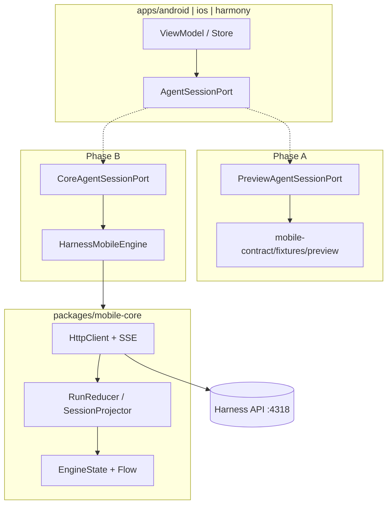
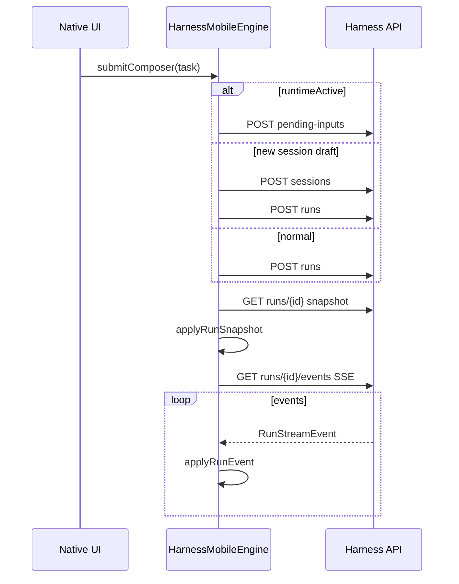
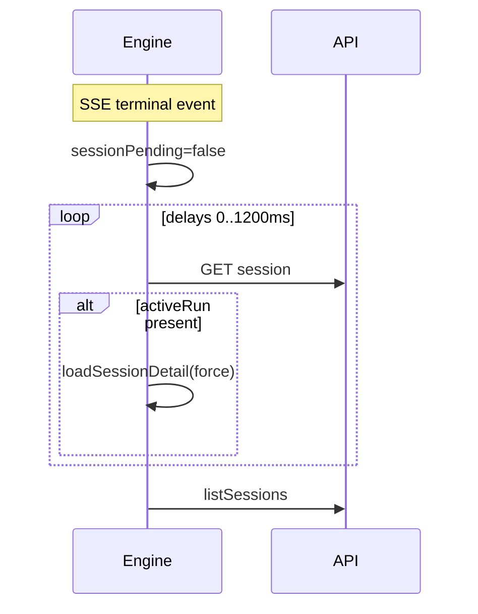

# Native Mobile Phase B — 联调规划与方案设计（Android + iOS + HarmonyOS）

> 文档类型：**Phase B 实施规划 + 技术方案**  
> 文档状态：**v1.3 — 功能开发专篇（Gate A 收口后可开工）**  
> 最后更新：2026-11-02  
> **范围说明**：本文只描述 **联调与功能实现**（Engine / Port / 验收用例）。**部署、监控、商店提审、E2E 发布流水线** 由后续专项文档覆盖，文中不再展开。
> 上级：[43-native-mobile-clients-architecture.md](./43-native-mobile-clients-architecture.md) §9.3（**B7 = 本文功能扫尾**；提审/Sentry/Maestro 见 43 **§16 Release**）、[44-native-mobile-phase-a-static-ui.md](./44-native-mobile-phase-a-static-ui.md)  
> **Parity 矩阵**：[36-mobile-agent-frontend.md](./36-mobile-agent-frontend.md) §4（M-* ID 验收）  
> **Web 行为对照**：`apps/web/src/app.tsx`、`packages/agent-client`（`createAgentClient`）、`agent-run-state`、`agent-conversation`  
> **范围**：仅 **Android / iOS / 鸿蒙原生**。**联调金标准 = Web + 共享 TS 包**。

---

## 1. 目标与边界

### 1.1 一句话目标

用户在 Settings 配置 **Harness API Base URL** 并通过 **`GET /readyz`** 后，三端 Native **Core 联调构建**与 Web `/agent` 使用 **同一 REST + SSE 语义**；UI **不重写 Screen**，仅将 `PreviewAgentSessionPort` 换为 **`CoreAgentSessionPort` → `mobile-core`**。

### 1.2 事实源（与 Web 一致）

| 层级 | 权威 |
| --- | --- |
| HTTP/SSE 协议 | [11-api-protocol.md](./11-api-protocol.md)、`packages/agent-protocol`（**以 Web 实际调用为准**；11 中部分 endpoint 为长期草案） |
| Run 归约 / cursor | [26-connection-durable-agent-loop.md](./26-connection-durable-agent-loop.md) |
| 联调验收 | 同一 `sessionId` / `runId` 下，**服务端 Snapshot / RunDetail** 为准；Mobile 与 Web 对照 |
| UI 投影形状 | `packages/mobile-contract/schema/active-session-state.schema.json`（Engine 主投影须可校验） |
| 能力 ID | [36 §4](./36-mobile-agent-frontend.md) M-SVC / M-SES / M-RUN / … |

### 1.3 明确不做（v1 Gate B）

- App 内嵌 NestJS / PostgreSQL  
- 服务端重启后 **自动续跑**（遗留 Run → `RUN_INTERRUPTED`，与 Web 一致）  
- FCM / APNs / Push Kit（推迟；见 43 §9.3 B6）  
- iPad 并排 IA（v1.1）  
- **鸿蒙不阻塞** Android + iOS 同时 Gate B（鸿蒙 **Gate B′** 见 §10）

### 1.4 与 Phase A 的关系

- **Preview 构建保留**：`PreviewAgentSessionPort` + 十场景 fixture；CI 持续 `validate:gate-a`。  
- Phase B **禁止**大规模改 Screen；UI 模型变更须同步 preview fixture + schema。  
- **Production 禁止双写 Session 状态**：Drawer CRUD、Run 投影只经 Engine；Preview 本地 Reducer 不得与 Core 并行写同一字段。  
- 建议 **Gate A 签字后** 启动 B0。

### 1.5 产品决策（v1 Native，写入验收）

| 项 | 决策 |
| --- | --- |
| **Workbench Context Tab** | Gate A Native Preview **未暴露** Context Tab（invariants）；Phase B v1 **继续不展示** Context Tab，与当前 Native UI 一致；Debug/Settings 可留 JSON 只读入口 **可选**。若产品要求与 Web 完全一致，单独立项 v1.1。 |
| **联调对照** | 同一账号下 Native vs **Web**（）Snapshot 对照。 |

### 1.6 本文不覆盖（见后续文档）

| 类别 | 说明 |
| --- | --- |
| 应用发布 | TestFlight / Play 内测渠道、版本号策略、灰度 |
| 运维监控 | Sentry、崩溃聚合、线上日志采样 |
| 自动化 E2E | Maestro / Detox 全链路发布门禁 |
| Push | FCM / APNs / Push Kit（功能也推迟，见 §1.3） |

---

## 2. Web 端参考架构（行为模板）

### 2.1 共享包职责（须在 `mobile-core` 等价实现）

| TS 包 | 职责 | Web 入口 |
| --- | --- | --- |
| `@harness/agent-protocol` | DTO / Zod | 全 API 解析、`ProblemDetails` |
| `@harness/agent-client` | REST + SSE | `createAgentClient()` |
| `@harness/agent-run-state` | `applyRunSnapshot` / `applyRunEventToSession` | 纯函数归约、duplicate/gap |
| `@harness/agent-conversation` | `observeRunConnection` | SSE 重连退避 `[0,1s,2s,4s,8s]` |
| `@harness/agent-projection` | Session 消息 → conversation 块 | `loadSessionDetail` 内 `toConversationItem` 等 |

### 2.2 主编排（`app.tsx`）— Phase B 必须复刻的语义

1. **就绪**：`getReadiness()` → `/readyz`；未登录也会检查（Composer 门禁）。  
2. **Public Config**：`getPublicAgentConfig()` → 模型列表、reasoning capability（发 Run 前 `selectedModel` 必填）。  
3. **鉴权**：未登录发送 → 存 pending 文案 + 打开登录；登录后继续。  
4. **Session 列表**：`listSessions`；Drawer；置顶排序与服务端一致。  
5. **选中 Session**：`loadSessionDetail`（见 §5 合并规则）；分页 `loadOlderMessages(before)`。  
6. **无选中 Session 首条发送**：`draftState` → `createSession` → `createRun`；`draftSubmissionToken` 防切走后会话错绑。  
7. **发送分支**：若 `pendingSessions[sessionId]` 或 `activeRunId` → **`submitPendingInput`**，**禁止**再 `createRun`（避免 active-run 冲突）。  
8. **发 Run**：乐观 user/assistant 本地 id → `createRun`（`idempotencyKey`、attachments、artifactVersionContext、skills）→ `observeRun`。  
9. **Run 观察**：每 `runId` 独立 AbortController/Job；**切换 Session 不 cancel**。  
10. **断流 / 终态**：非终态断流 → `getRun` Snapshot；终态 → `refreshSessions` + **`syncFollowUpAfterTerminal`**（轮询 `getSession`）。  
11. **Workbench 补水**：`hydrateRunDetail(runId)`（`getRunDetail`）与 Session 详情里的 artifact/workbench 合并。  
12. **HITL / 队列**：pending-inputs promote/send/cancel/resume + `controlRun`（B4）。  
13. **登录续发**：未登录提交 → `pendingSubmitTask`；登录成功后 **自动重试同一 task**（须防重复 idempotency）。  
14. **附件就绪**：上传后若 `status === processing`，**轮询 `getFile`** 直至可发 Run（B3）。  
15. **删除 Session**：`DELETE` 后清本地 `sessionCache`；若删的是当前选中 → **列表首条或 draft**（`startDraft`）。  
16. **Workbench 本地态**：`workbenchOpen` / `followMode` **不上传服务端**；Native 输出期间不自动打开，Focus 前常 `hydrateRunDetail`。

### 2.3 完整 API 面（对齐 `createAgentClient`）

路径前缀 `{baseUrl}`。实现顺序见 §6.3 Parity 映射。

| 模块 | 能力 | 方法 / 路径 | 典型里程碑 |
| --- | --- | --- | --- |
| readiness | 就绪 | `GET /readyz` | B0 |
| config | Public Config | `GET /api/agent/config/public` | B0 |
| sessions | 列表 / 创建 / 详情 / 更新 / 删除 | `GET/POST/PATCH/DELETE /api/agent/sessions…` | B1 |
| sessions | 标题生成 | `POST …/sessions/:id/title/generate` | B1+（可选） |
| runs | 创建 / Snapshot / Detail | `POST …/runs`、`GET /runs/:id`、`GET …/detail` | B2 |
| runs | SSE | `GET …/runs/:id/events` + `Last-Event-ID` | B2 |
| runs | 取消 / 控制 | `POST …/cancel`、`POST …/commands` | B2 / B4 |
| pending-inputs | Steer / Follow-up 队列 | `POST …/sessions/:id/pending-inputs`；`POST …/pending-inputs/:id/{steer,send,cancel}`；`POST …/pending-inputs/resume` | **B2 末 / B3** |
| files | 上传 / 预览 / retry / delete | `packages/agent-client/src/files.ts` | B3 |
| artifacts | 元数据 / 系列 / restore / reports | `packages/agent-client/src/artifacts.ts` | B5 |
| skills | Skill 列表 | `skills.ts` | B3 |
| mcp / memories | Settings Host API | `mcp.ts` / `memories.ts` | B6 |
| sse | 帧解析 | `\n\n` + `data:` JSON → `RunStreamEvent` | B2 |

> **注意**：[11-api-protocol.md](./11-api-protocol.md) 中部分 clarification/steer 路径为长期目标；**以 Web 当前使用的 pending-inputs + commands 为准**。

---

## 3. 目标架构（三端）



### 3.1 分层原则（43 §5.4）

| 层 | 位置 | 规则 |
| --- | --- | --- |
| **Engine** | `packages/mobile-core` | 唯一 HTTP/SSE；Run 归约；cursor；Session 缓存与合并策略 |
| **Port** | `CoreAgentSessionPort` | 暴露 `ActiveSessionState` + 命令；映射 Engine Flow |
| **ViewModel** | 各端 feature | **只依赖 Port**；禁止 Screen 直连 HTTP/SSE |
| **Preview** | Preview Port | fixture + Replay；与 Core **同一 UI 模型** |

### 3.2 Engine 内存模型（与 Web ref 对照）

Web 除 `sessionStates[sessionId]` 外还有旁路状态；Native Engine 建议显式建模：

| 状态 | 说明 | 是否进 schema |
| --- | --- | --- |
| `selectedSessionId` | 当前选中 | Port 字段 |
| `sessionList` | Drawer 列表 | `sessionDrawer` 或独立 Flow |
| `activeSession` | 选中 Session 投影 | `ActiveSessionState` |
| `sessionCache` | 非选中 Session 的轻量/完整缓存 | Engine 内部 |
| `pendingSessions` | 按 sessionId：是否有 active Run / 提交中 | Engine 内部（**M-SES-7**） |
| `runObservers` | runId → Job + cursor | Engine 内部 |
| `pagination` | sessionId → `nextBefore` | Engine 内部 |
| `publicConfig` | 模型与 capability | Engine / Settings |
| `connection` | M-SVC-4 枚举 | Port Flow |
| `auth` | 登录态、401 收敛 | Port / Auth 模块 |

### 3.3 `mobile-core` 模块划分（建议）

```text
packages/mobile-core/
  core-api/           # 对齐 agent-client 全模块
  core-auth/          # 会话 Cookie header；见 §4.3
  core-reducer/       # agent-run-state + projection 语义
  core-engine/        # HarnessMobileEngine
  core-test/          # domain + run-events golden
  iosExport/          # XCFramework
  ohosArm64/          # Gate B′
```

### 3.4 构建与 Port 注入（开发期）

| 端 | Preview（Gate A） | Core 联调 |
| --- | --- | --- |
| **Android** | `preview` → `PreviewAgentSessionPort` | `production` flavor → `CoreAgentSessionPort` |
| **iOS** | Preview target | Core target + `mobile-core`（XCFramework 或短期 Swift 薄层，见 §11） |
| **鸿蒙** | Preview 入口 | B′：NAPI；B0～B1 可用 ArkTS 薄 HTTP **仅联调**，golden 仍在 JVM |

Settings Phase B：**持久化** `apiBaseUrl`、主题、字号、auth token（若有）——属 **功能配置**，与发布流水线无关。

---

## 4. `AgentSessionPort` 扩展设计

Phase A 接口过小；B0 起三端 **签名对齐**（鸿蒙 `AgentSessionPort.ets` 须补 `sessionState` 订阅）。

### 4.1 只读订阅

```kotlin
// 语义示意（Kotlin）
interface AgentSessionPort {
    val activeSession: StateFlow<ActiveSessionState>
    val sessionList: StateFlow<List<SessionDrawerItem>>
    val connectionState: StateFlow<ConnectionState>
    val sessionDetailLoading: StateFlow<Boolean>  // 当前选中 session
    val canLoadOlderMessages: StateFlow<Boolean>
}
```

**ConnectionState** 对齐 **M-SVC-4**（不少于）：`idle | connecting | live | reconnecting | offline`；另可映射 `readyz` 失败为 `serviceUnavailable`。

- tail 更新 ~100ms 批量（43 §10）。  
- 错误用 **ProblemDetails**（M-SVC-5），禁止向 UI 暴露 stack/API Key。

### 4.2 Preview 专用

- `loadPreviewFixture(fileName)`、`listPreviewFixtures()`

### 4.3 连接、Config、鉴权（B0）

| 方法 | 对照 |
| --- | --- |
| `refreshReadiness()` | `getReadiness()` |
| `refreshPublicConfig()` | `getPublicAgentConfig()` |
| `signIn` / `signOut` / `authState` | 见下表；API 同 Web `login-dialog`（`/api/auth/*`） |

**鉴权（跟后端，不另搞 Bearer/OAuth/WebView）**

| 项 | 做法 |
| --- | --- |
| 后端 | `AUTH_MODE=local` → 不发 Cookie，Guard 本地用户；`required` → 只认 Cookie **`harness_session`**（`AUTH_COOKIE_NAME`）。Guard **不读** 用户层 Bearer。 |
| Native 带会话 | verify 解析 **`Set-Cookie`** → 存 token 值 → 每条 **REST + SSE** 加 `Cookie: harness_session=<token>`（与 Web `/agent` 会话 cookie 语义一致）。 |
| 登录 UI | **原生**邮箱/手机 + 验证码；**不用** WebView 登录页。 |
| token 存放 | 只存 Cookie **value**；与 `apiBaseUrl`/主题 **分库**：Android EncryptedSharedPreferences / DataStore+MasterKey；iOS **Keychain**；鸿蒙 HUKS / Asset Store（勿明文 preferences）。 |
| `core-auth` | `getSessionCookieHeader()` / `setSessionToken` / `clearSessionToken`（KMP expect/actual）；`createClientContext` 用 `getAuthHeaders`（见 `agent-client` `http.ts`）。 |
| 401 / 登出 | 401 `AUTH_REQUIRED` → `authUser=null`、**abort 全部 SSE**（§8 E9）、引导登录；登出 `POST /logout` + 清本地 token。未登录发送 → `pendingSubmitTask`，登录成功后自动重试（§5.4）。 |
| Preview | 不接真 auth；fixture 模拟 `LOGIN_REQUIRED`。 |

**B0 落地**：Core 组；**B0 启动后 3 个工作日**内 `core-auth` + Android 首端。

### 4.4 Session（B1）

| 方法 | 对照 |
| --- | --- |
| `refreshSessionList()` | `listSessions()` |
| `selectSession(id)` | 选中 + `loadSessionDetail` |
| `loadSessionDetail(id, force)` | 见 §5 |
| `loadOlderMessages()` | `getSession(id, { before })` |
| `beginNewConversation()` | 本地 draft 态；等价 Web 无 selectedSession |
| `createSession(title)` | 首条发送前创建 |
| `updateSession` / `deleteSession` | PATCH / DELETE |
| `removeSession(id)` | DELETE + 本地缓存清理 + **导航落点**（§5.7） |
| `generateSessionTitle(id)` | 可选 |

Drawer 长按菜单 **B1 起只调 Port**；删除 Preview ViewModel 假 CRUD。

**Engine 同步写 Ref（Web 同等约束）**：`selectedSessionId`、`pendingSessions` 在命令入口 **与 Flow 同 tick 更新**，避免「新建 Session 后立即发送」路由到旧 session（S1）。

### 4.5 发送与 Run（B2～B3）

| 方法 | 对照 |
| --- | --- |
| `submitComposer(task, …)` | 内部分支：pending-input **或** createRun + observeRun |
| `submitPendingInput(content)` | `POST …/pending-inputs` |
| `promotePendingInput` / `sendPendingInput` / `cancelPendingInput` | pending-inputs API |
| `cancelActiveRun()` | `cancelRun` |
| `resumePendingQueue()` | 队列恢复 |
| `uploadAttachment` / `removeAttachment` / `retryAttachment` | `files.ts`；processing 轮询至可提交 |
| `onAuthSuccess()` | 消费 `pendingSubmitTask`（§5.4） |

Engine 内部：`observeRun(sessionId, runId)` → `observeRunConnection`；**不暴露 SSE 给 UI**。

### 4.6 HITL / Control（B4）

| 方法 | API |
| --- | --- |
| `respondClarification` / `respondToolApproval` | commands / pending-inputs（与 Web 当前路径一致） |
| `controlRun(command)` | `POST …/commands` |

### 4.7 Workbench / Reader（B5）

- `hydrateRunDetail(runId)`、`refreshWorkbench`、Artifact restore 等对齐 `artifacts.ts`。  
- `focusWorkbench(target)` / `openWorkbenchPanel()`：先 hydrate（可失败静默），再 `mergeWorkbenchDeliverables` + `followMode: pinned`（M-CONV-7）。  
- `beginArtifactRevision(artifact)` / `clearRevisionContext()`：写入 `revisionContext` + 预填 Composer（M-CMP-13）。  
- `restoreArtifactVersion(artifact)`：带 `expectedCurrentArtifactId`，成功后 `loadSessionDetail(force)`。  
- **Workbench 本地**：`setWorkbenchOpen`、`suppressAutoOpen(runId)`、`setFollowMode`（不持久化服务端）。  
- **Context Tab**：v1 Native UI **不展示**（§1.5）；Engine 仍可保留 `context` 字段供 Debug 只读。

### 4.8 Settings（B6）

- `SettingsPort` 或扩展：**MCP** CRUD + Test（M-SET-3～5）；**Memory** list/create/update/delete + settings patch（`memories.ts`，与 Web Settings 暴露范围一致）。  
- M-SET-1～2（主题/字号）若 Phase A 已纯本地，B6 仅需 **不因联调回归**；无 API。

### 4.9 App 生命周期（B2 起设计，B6 硬化）

| 方法 | 行为（M-RUN-6） |
| --- | --- |
| `onAppBackground()` | 关闭所有 SSE 连接；**不 cancel Run** |
| `onAppForeground()` | `listSessions`；对 activeRun `getRun` + 重新 `subscribeRun(Last-Event-ID)` |

v1 **无推送**：用户回前台依赖 Session 扫描发现已完成 Run。

---

## 5. Engine 不变量：Session 详情合并与 Run 观察

本节复刻 Web `loadSessionDetail` / `observeRun` / `hydrateRunDetail` 的 **必须行为**；`mobile-core` 单测应覆盖。

### 5.1 `loadSessionDetail(sessionId, force)` 规则

| # | 条件 | 行为 |
| --- | --- | --- |
| R1 | `pendingSessions[sessionId] == true` | **直接 return**（Run 进行中禁止详情覆盖 Live 投影） |
| R2 | 非 force 且已 loaded 或请求 in-flight | 去重 return |
| R3 | 请求开始 | 非 force 时标记 loaded（防导航双击） |
| R4 | 成功 | 写入 `pendingUserInputs`；合并 conversation（见 R5–R7） |
| R5 | 合并 | `mergePendingSteerState` + 保留本地 pending 用户消息（pendingInputId 去重） |
| R6 | 合并 | `preferRicherAssistant`：不可用旧详情 **覆盖** 更丰富的 live assistant 块 |
| R7 | 分页 | 首页 `limit=100`；保存 `pagination.nextBefore` |
| R8 | 若 `session.activeRun` | `setSessionPending(true)` + `observeRun` |
| R9 | 否则 | 对最近 assistant runId 可选 `hydrateRunDetail`（Workbench 补水） |
| R10 | 请求返回前 `pendingSessions[sessionId]` 变为 true | **丢弃本次 merge**（与 R1 二道闸） |
| R11 | Workbench 合并 | 保留 `open` / `activeView` / `followMode` / `autoOpenSuppressedRunIds`；`mergeWorkbenchDeliverables` + 已有 `context` |
| R12 | 无 live assistant workbench | 可用 `artifactSeries` 合成占位 workbench（subtitle 文件数）；仍遵守 Native **不展示 Context Tab** |
| R13 | `sessionDetailLoading` | 仅当该 session **无缓存** 时置 loading（避免切回已缓存会话闪 skeleton） |

### 5.2 `syncFollowUpAfterTerminal(sessionId)`

终态 SSE 后 **短窗口**内新 Run 可能尚未出现在首次 detail：

- 延迟序列 **`[0, 150, 350, 700, 1200]` ms** 轮询 `getSession`。  
- 发现 `activeRun` → **`loadSessionDetail(sessionId, force=true)`** 并 return。  
- 最后一轮若无 activeRun 仍 **force refresh** 一次（清理已消费队列 UI）。  
- 每轮若 `pendingSessions[sessionId]` → **skip**（与 Web 一致）。  
- Engine **dispose** 后中止循环（等价 Web `disposedRef`）。

**B2 验收必测**：Follow-up 自动出现，无需用户手动刷新。

### 5.3 Run 观察与 Snapshot

| # | 规则 |
| --- | --- |
| O1 | 每 runId 至多一个 observer；重复 `observeRun` 忽略 |
| O2 | cursor 单调；`duplicate` 丢弃；`gap` → 抛错并重连 |
| O3 | 非终态断流 → `getRun` 补 Snapshot + 续订 SSE |
| O4 | 终态 → `syncFollowUpAfterTerminal` + `refreshSessionList` |
| O5 | **`hydrateRunDetail` 与 live SSE 并行** 时 Workbench 用 `mergeWorkbenchDeliverables`，保留 `open` / `context` / `plan` 用户态 |
| O6 | 非终态 SSE 错误 | 设置 `reconnectRunId`（或 ConnectionState `reconnecting`）+ Snapshot 补齐；**不**清 conversation |
| O7 | Reducer 返回 `errorDetail` | 仅 **当前选中 session** 展示 ProblemDetails（M-SVC-5） |
| O8 | `observeRun` finally | **终态**：`sessionPending=false` → `syncFollowUpAfterTerminal`；**非终态断流**：`getRun` + `applyRunSnapshot` |

### 5.4 发送路径（`submitComposer`）

```text
trim(task) 为空 → return
authChecking → return（不丢文案）
未登录 → pendingSubmitTask + 打开登录；登录成功后自动 submitComposer(task)
runtimeActive = pendingSessions[sessionId] || activeRunId   // 必须读 Ref/同步快照，禁止闭包 stale
  → submitPendingInput（禁止 createRun）；清空 Composer；合并 pendingInputs UI
draft 且 draftPending → return（防连点）
draft 首条无 sessionId
  → draftPending=true → 乐观 UI → createSession →（draftToken 匹配才）selectSession → createRun
否则
  → 乐观 user/assistant → createRun(idempotencyKey, attachments, artifactVersionContext, skills)
  → 映射 userMessageId/assistantMessageId → activeRunId → observeRun
finally（createRun 路径）
  → sessionPending 短暂 false（createRun 返回后）；Run 观察/reducer 再置 true/false
  → draftToken 匹配才 draftPending=false
失败
  → 已有 sessionId：assistant deliveryStatus=failed + 固定失败文案块；refreshSessionList（失败不 rollback 已成功部分）
  → 纯 draft 失败：恢复 prompt + 清空 draft 乐观态
```

**M-CMP-12**：若 public config / session 标记 transcript 不兼容 → Composer `disabled` + 引导新建 Session（对齐 Web）。  
**M-CMP-1**：Composer 模式由 **interrupt 类型 + runtimeActive + readiness + M-CMP-12** 推导（`new-run` / `steer` / `clarification` / `disabled`），Port 或 ViewModel 暴露 **`composerPlan`**（与 Gate A schema 一致）。

### 5.5 乐观 UI 与幂等

- 本地 `local-user-*` / `local-assistant-*` id；服务端 messageId/runId 到达后 **按 reducer 规则 merge**，不重复插入。  
- `createRun` / pending-input 均带 **idempotencyKey**（见 agent-client）。  
- 附件：乐观展示须与 `optimisticRevisionAttachments(revisionContext)` 规则一致（revise 场景）。

### 5.6 `loadOlderMessages(sessionId)`

| # | 规则 |
| --- | --- |
| P1 | 无 `nextBefore` 或该 session 已在 loadingOlder → return |
| P2 | `GET session` `{ limit: 100, before }` |
| P3 | 按 message **id 去重**，**prepend** 到 conversation，按 `createdAt` 排序 |
| P4 | 更新 `pagination.nextBefore` |
| P5 | **不**走 R1 阻止（历史分页与 live Run 可并行）；但 **不得**用旧页数据覆盖 live assistant  richness（可对冲突 id 走 `preferRicherAssistant`） |

### 5.7 导航与 Session 生命周期

| 动作 | 行为 |
| --- | --- |
| `selectSession(id)` | `draftToken++`；清 error、Composer 文案、**当前选中 session 的 pendingInputs UI**；先展示 `sessionCache`；无缓存且未 in-flight 才 `loadSessionDetail`；**不 abort** 任何 `runObservers` |
| `beginNewConversation()` | 等价 Web `startDraft`：无 DB 写入；`selectedSessionId=null` + 空 draft 投影 |
| `removeSession(id)` | API DELETE → 删 `sessionCache` / pagination / pendingSessions 条目；`refreshSessionList`；若删当前选中 → 列表第一项或 draft |
| 置顶 PATCH | `refreshSessionList` 后排序与 Web 一致（pinned 在前） |

### 5.8 Pending Inputs 与队列 UI

- **Session 级**：`session.pendingUserInputs` 经 detail 合并 + reducer 更新。  
- **选中 Session 级 UI 列表**：Engine 维护 `pendingInputs`（`uniquePendingInputs`）；`selectSession` **清空展示**，detail 加载后回填。  
- **M-PND-1**：submit / promote / send / cancel / resume 全路径与 `pending-inputs.ts` 一致（B2 末～B4）。

### 5.9 Workbench 交互不变量

- Native App 输出过程中不自动弹出 Workbench；Workbench 只在用户点击顶部入口或具体工具步骤时打开并定位。Web 端仍保留自己的 auto-open 交互。  
- `focusWorkbench`：无法解析 target → **降级 Activity 总览** + 轻提示（与 Web §14.1 一致）。  
- 点击 Activity（M-CONV-7）：`open → activeView → focusTarget → scroll` **原子**更新。  
- `cancelActiveRun`：Workbench `activityStatus: cancelling`（M-RUN-4）；cancelling 期间禁重复 cancel。

### 5.10 取消、销毁与资源

| 场景 | 行为 |
| --- | --- |
| App 进程结束 | v1 **不持久化** SSE cursor；冷启动走 §6.3 |
| `Engine.dispose()` / 用户登出 | abort **全部** SSE；清 observer map |
| 删除 Session | v1 **不强制** abort 该 session 后台 observer（与 Web 同）；删后 UI 不再订阅该 cache，observer 自然结束于终态或错误 |
| 附件上传 cancel | abort 该 fileId 的上传 Job（Web `attachmentControllersRef`） |

### 5.11 Run 进行中会话投影与 Web 对齐（B2 必达）

> **动机**：当前 `RunLiveReducer` 将 `message.delta` 累加为单一 `assistantText`，未实现 Web `blocks` + `presentAssistantBlocks` 的 **process / pending / final** 划分，导致 Run 中 **思维链、commentary、多轮正文** 与 Web 不一致。本节规定 **语义对齐** 的目标、边界与落地步骤；**不要求** Streamdown 级流式 Markdown 或 Preview Replay 行为。

#### 5.11.1 目标与非目标

| 类别 | 内容 |
| --- | --- |
| **目标** | 同一 `runId`、同一 SSE 序列下，Native 与 Web 在 **时间线 `process`**、**正文 `pendingText` / `finalText`**、**`pending` 标记**、**R6 richer merge** 上语义一致；终态仍以 **session detail / 持久化 blocks** 为准（与 Web 相同）。 |
| **非目标（v1 Gate B）** | Streamdown / incomplete Markdown 流式解析；Preview `ReplayController` 改为 SSE；消息内 artifact 卡片；整份 `AgentUiState` + Workbench 全分支 1:1 搬进 KMP。 |

#### 5.11.2 目标数据流

```text
RunStreamEvent
  → applyRunEvent（conversation 分支，对齐 agent-run-state）
  → LiveRunState.blocks[]（与 agent-protocol assistant blocks 同构）
  → presentAssistantBlocks 等价（对齐 agent-conversation）
  → MobileConversationLine(process, pendingText, finalText, pending, deliveryStatus)
  → CoreSessionMapper → Gate A ConversationItem → ProcessTimeline / AssistantMessageBubble
```

**单一事实来源**：Run 进行中以 `LiveRunState.blocks` 为准；**禁止**再用 `assistantText += delta` 作为唯一正文投影路径（实现完成后代码审查可检索验证）。

#### 5.11.3 `MobileConversationLine` / Port 映射

Engine 投影须扩展（`core-api` `SessionModels.kt`），并与 schema 同步（§9）：

| 字段 | 含义 |
| --- | --- |
| `pendingText` | 对齐 Web `presentation.pendingText`（pending phase 文本块） |
| `finalText` | 对齐 Web `presentation.finalText` |
| `pending` | 对齐 Web `item.pending`（Run 进行中 assistant） |
| `process` | 对齐 Web `presentation.process`（reasoning / tool / commentary text） |
| `content` | **deprecated**：仅兼容或 detail 回填；= `pendingText + finalText` 或由持久化 message 推导 |

**Production `CoreSessionMapper`（Android / iOS）**：

- 流式：`pendingText ← line.pendingText`；`markdownContent ← null`；`tailTarget ← null`（Production 不用 Replay）。
- 完成：`markdownContent ← line.finalText`（或 completed 时 pending 已空）。
- UI：`finalOutputVisible` 须考虑 `pendingText` / `finalText`，不可仅看 `markdownContent`（避免时间线折叠与 Web 不一致）。

**Preview（Gate A）**：`PreviewAgentSessionPort` + Replay **行为不变**；仅当 schema 增字段时更新 fixture 可选字段，不要求 Replay 模拟 block phase。

#### 5.11.4 Engine 应对齐的 TS 函数（`core-engine`）

| Kotlin（建议路径） | 对照 TS |
| --- | --- |
| `conversation-blocks.kt` | `packages/agent-conversation/src/conversation-blocks.ts` |
| `assistant-presentation.kt` | `packages/agent-conversation/src/assistant-message-adapter.ts` |
| `apply-run-event.kt`（conversation 子集） | `packages/agent-run-state/src/apply-run-event.ts` |
| `apply-run-snapshot.kt` + richer merge | `apply-run-snapshot.ts`、`preferRicherAssistant` |
| `RunLiveReducer.kt` | 薄层：cursor / duplicate / gap → 委托上述纯函数 |

**必须处理的 Run 事件**（与 Web 同序语义）：`message.delta`、`message.phase.completed`、`message.discarded`、`reasoning.delta`、`model.round.completed`、`tool.started|completed|failed|cancelled`、`run.completed|failed|cancelled`、`run.snapshot`。

**必须移除或替换的反模式**：

- Snapshot 合并时 **incoming 含 reasoning 即整表替换** `assistantProcess`（现 `mergeReasoningProcess`）；改为 **按 block id / toolCallId 与 Web 同类 richer merge**（落实 R6 精神）。

**Detail 持久化**：`SessionSnapshotProjector.toConversationLine(assistant)` 须与 live 路径共用 **同一套** `presentAssistantBlocks` 等价逻辑（从 `metadata.blocks` 解析），避免 live / detail 两套叙事。

#### 5.11.5 契约 golden（`mobile-contract` + `core-test`）

| 路径 | 用途 |
| --- | --- |
| `fixtures/run-events/*.json` | SSE 序列 fixture（扩展现有 `message-delta-seq4.json`） |
| `fixtures/run-events/expected/*.json` | 终态（或逐步）presentation golden |
| `mobile-contract/scripts/`（可选） | 读 fixture → 跑 TS `applyRunEventToSession` + `presentAssistantBlocks` → 生成 expected |

**首期三条验收场景（S1–S3，B2 Gate 必测）**：

| ID | 场景 | 事件特征 | 通过标准 |
| --- | --- | --- | --- |
| **S1** | reasoning + tool | `reasoning.delta*` → `tool.*` → final `message.delta` | process 含 reasoning + tool；final 仅在正文区；KMP golden == TS expected |
| **S2** | commentary + tool + final | `text.delta` phase=commentary → tool → `message.phase.completed` → final_answer | commentary 在 process text，**不**堆进单一 pending 全文 |
| **S3** | 多轮 final | 两轮 tool round、各段 final/pending text | block 分轮与 Web 一致；**不得**单字符串混排 |

```bash
pnpm --filter @harness/mobile-core test   # 含 RunPresentationGoldenTest / S1–S3
```

#### 5.11.6 分阶段实施（挂 B2 / B7）

| 阶段 | 里程碑 | 交付 |
| --- | --- | --- |
| **P0** | B2 前半 | golden 脚本 + S1 fixture + TS expected；`AssistantBlock` 字段与 protocol 对齐说明 |
| **P1** | **B2 核心** | `conversation-blocks` + `apply-run-event` + `RunLiveReducer` 切 `blocks`；S1–S3 golden 绿 |
| **P2** | B2 末 | `CoreSessionMapper` + Bubble `finalOutputVisible`；Android/iOS 与 Web 并排手验 S1–S3 |
| **P3** | B7 可选 | `publishLiveRun` presentation 不变则跳过或 50ms coalesce；流式 MD 增强（M-CONV-5 深化） |

#### 5.11.7 Definition of Done（Run 投影）

- [ ] `core-test`：S1–S3 golden 全通过；无 `assistantText += delta` 唯一正文路径。
- [ ] R6：`preferRicherAssistant` 类行为有对应单测（snapshot 不覆盖更 rich 的 live tool 步）。
- [ ] Production 联调：同一 API Run，Native 与 Web **process 步数 + pending/final 文本** 一致（§14 手验记录可引用 S1–S3）。
- [ ] Gate A：`pnpm validate:gate-a` 不回归；Preview Replay 路径未改语义。

---

## 6. 数据流

### 6.1 发消息到流式（happy path）



### 6.2 Terminal → Follow-up



### 6.3 冷启动 / 回前台

1. `refreshReadiness` + `refreshPublicConfig`  
2. `listSessions`；恢复 `selectedSessionId`（深链 **M-SES-6** 可选 B1+）  
3. `loadSessionDetail`；若 `activeRun` → `observeRun`  
4. v1 **不持久化** cursor → Snapshot 全量对齐 → SSE 续订（`Last-Event-ID` 来自内存 seq）  

---

## 7. 里程碑规划（B0～B7）

与 [43 §9.3](./43-native-mobile-clients-architecture.md) 对齐；**Android + iOS 并行**；鸿蒙 **Gate B′**（§10）。

| 里程碑 | 交付 | 验收摘要 |
| --- | --- | --- |
| **B0** | mobile-core 骨架；Core Port；URL + readyz + **public config** | Gate A 仍绿；M-SVC-1/2/3；ProblemDetails 通路 |
| **B1** | Session CRUD；Drawer；detail 合并 R1–R13；分页 P1–P5；draft 首发 | M-SES-1～5；与 Web 列表一致 |
| **B2** | createRun + SSE + cancel + pending-input 分支；Follow-up 重试；**§5.11 Run 投影与 Web 对齐（S1–S3 golden）**；M-RUN-6 设计 | M-RUN-1～4、7；M-CONV-1～3（含 CoT / pending-final 语义） |
| **B3** | 模型/推理/Skill/附件/revisionContext；M-CMP-12 | M-CMP-1～3、10～11、13 |
| **B4** | HITL + pending 队列 UI + controlRun 子集 | M-CMP-4～7、M-RUN-5 |
| **B5** | Workbench 真数据 + hydrateRunDetail + Focus | M-CONV-7、§4.7 Workbench 行为 |
| **B6** | MCP/Memory；前后台恢复硬化；杀进程矩阵 | M-RUN-6、Settings §4.8 |
| **B7** | **功能 Parity 扫尾**（非发布） | M-CONV-4～8、M-PND-1 闭环、M-SES-6（若未做）、Memory UI；36 §4 功能项清零 |

> **B7 不含**：Sentry、商店提审、Maestro/Detox 发布门禁 — 见 §1.6 后续文档。

### 7.1 Parity ID → 里程碑映射（节选）

完整矩阵见 [36 §4](./36-mobile-agent-frontend.md)。

| ID | 里程碑 | 备注 |
| --- | --- | --- |
| M-SVC-1 | B0 | readyz |
| M-SVC-2 | B0 | public config |
| M-SVC-3 | B0 | Settings URL |
| M-SVC-4 | B0 骨架，B2 完善 | reconnecting 与 run 观察绑定 |
| M-SVC-5 | B0+ | ApiProblem → UI |
| M-SES-1 | B1 | draft + createSession |
| M-SES-2～5 | B1 | Drawer CRUD |
| M-SES-6 | B1+ / B7 | 深链可后置 |
| M-SES-7 | B2 | pendingSessions + activeRunId；Ref 同步 S1 |
| M-RUN-1～4, 7 | B2 | 含 idempotency、optimistic、O6～O8 |
| M-RUN-5 | B4 | commands 子集（含 pause/resume 若 Web 已暴露） |
| M-RUN-6 | B2 设计，B6 验收 | 前后台 |
| M-PND-1 | B2 末 / B4 | §5.8 全 API |
| M-CMP-1 | B2+ | composerPlan 推导 |
| M-CMP-4～7 | B4（队列 UI B2 末起） | HITL + Follow-up promote/send/cancel |
| M-CMP-8～9 | B2～B3 | Plan 浮卡、Context 环 |
| M-CMP-10～11 | B3 | 附件、粘贴长文本阈值 |
| M-CONV-1～3 | B2 | 基础块与顺序；**§5.11** process / pending / final 与 Web 一致 |
| M-CONV-4～6, 8 | B3～B7 | CoT 体验深化、Markdown、长列表、复制（§5.11 P3 可选） |
| M-CONV-7 | B5 | Focus + §5.9 |
| M-FILE-* | B3 | 上传 + processing 轮询 |
| M-ART-* / M-RPT-* | B5 | Artifact / Report / revise / restore |
| M-SET-1～2 | A 或 B7 | 主题字号（无 API） |
| M-SET-3～5 | B6 | MCP |
| Memory API | B6 | `memories.ts` 与 Web Settings 对齐 |

### 7.2 建议时间线

```text
Week 1–2   B0 + B1（含 §5 合并规则单测）
Week 3–4   B2（含 pending-input + Follow-up 重试）
Week 5–6   B3
Week 7     B4
Week 8–9   B5
Week 10    B6（含 M-RUN-6 矩阵）
Week 11+   B7 功能扫尾；鸿蒙 B′ 可与 B6 起并行
```

### 7.3 各端工程清单（B0/B1）

**Android**：production flavor；`SessionViewModel(port)`；DataStore（url + auth）；**禁止** Production 写 PreviewStore。

**iOS**：Scheme 分离；XCFramework 或短期 Swift HTTP（**债务登记**）。

**鸿蒙**：Port 签名与 Android 一致；`sessionState` Flow；B′ 前 HTTP 薄层联调。

---

## 8. 边界条件与竞态（验收用例）

| # | 场景 | 期望 |
| --- | --- | --- |
| E1 | 快速切换 Session，detail 请求晚到 | 只更新对应 sessionCache，不改当前 UI 若已切走 |
| E2 | Run 中 force loadSessionDetail | R1 阻止；仅 observer 更新 live |
| E3 | 双击发送 | 第二击 pending-input 或忽略 |
| E4 | Terminal 后立即发下一条 | Follow-up 或新 Run；无 active-run 409 |
| E5 | SSE gap | 重连；不 duplicate UI item |
| E6 | 切 Session 后后台 Run 完成 | 列表刷新；切回 Session 看到终态 |
| E7 | draft 发送中用户切 Session | Run 仍观察；选中仅 draftToken 匹配时更新 |
| E8 | 弱网 / 飞行模式 | offline + 可重试；恢复后 Snapshot+SSE |
| E9 | 401  mid-run | 收敛 observer；提示登录；不崩溃 |
| E10 | 杀进程再开 | 无 cursor 持久时靠 Session+getRun 恢复 |
| E11 | 长 thread 100+ | 分页加载；FPS 不低于 Gate A 基线 |
| E12 | 服务端重启 | Run 显示 INTERRUPTED；不假续跑 |
| E13 | detail 响应途中 Run 开始 | R10 丢弃 stale merge |
| E14 | createRun 成功但 observe 未连上 | `activeRunId` 仍阻止重复 createRun；Snapshot+SSE 恢复 |
| E15 | createRun 失败 | failed assistant 块；session 内 user 消息保留；draft 恢复 prompt |
| E16 | draftPending / authChecking | 第二次 submit 被忽略 |
| E17 | 切 Session 再切回 | pendingInputs UI 随 detail 重建；后台 Run 仍更新 cache |
| E18 | Engine dispose 中 syncFollowUp | 轮询中止；无崩溃 |
| E19 | 附件仍 processing 时发送 | 阻塞或提示（与 Web：先 poll 就绪） |
| E20 | public config 未加载 | 禁止 createRun；明确错误文案 |
| E21 | listSessions 在 createRun 后失败 | 对话仍可见；侧栏可手动刷新 |
| E22 | 删除当前 Session | 落下一 Session 或 empty draft；无 orphan 选中 id |
| E23 | loadOlder 与 live 同 id | preferRicherAssistant / 不 duplicate |
| E24 | 终态 SSE 与 syncFollowUp 交叉 | pendingSessions skip 轮次；最终 force detail |
| E25 | 删 Session 时该 Run 仍在服务端跑 | UI 不再展示；observer 可静默跑至终态（与 Web） |
| E26 | 登录取消 | 清空 pendingSubmitTask；不自动发送 |
| E27 | Focus 目标 run 无 workbench | hydrate 后仍无 → 降级 Activity |
| E28 | restoreArtifact 并发冲突 | ProblemDetails；不 corrupt 本地 series |

### 8.1 相对 Web 仍易漏的实现点（开发自检）

| 项 | 常见遗漏 |
| --- | --- |
| Ref 与 Flow 双写 | 仅更新 StateFlow 未更新同步 Ref → 错 session 发 Run |
| pendingSessions 仅看 boolean | 忽略 `activeRunId` → active-run 409 |
| selectSession | 误 abort SSE → 后台 Run 丢事件 |
| loadSessionDetail force | Run 中 force 绕过 R1 → live 被覆盖 |
| pendingInputs | 全局一份未按 selectedSession 隔离 |
| Workbench | 只 merge deliverables 未保留 `open`/tab |
| Composer | 未实现 `draftPending` / `authChecking` 门禁 |
| 取消 Run | 未置 `cancelling` → 重复点击 |
| 粘贴/长文本附件 | M-CMP-11 阈值 4000 code points（B3） |
| Skills | createRun body 漏 `skillNames`（B3） |

---

## 9. 测试与门禁

| 类型 | 要求 |
| --- | --- |
| **core-test golden** | run-events + domain；`applyEvents == expected`；**§5.11 S1–S3** presentation 与 TS expected 一致 |
| **schema** | Engine 投影 `ActiveSessionState` 校验 |
| **§5 规则** | R1–R13、O1–O8、P1–P5、§5.7～5.9 关键路径 |
| **集成** | 抽样真 API；同 sessionId Web 对照 Snapshot |
| **Gate A** | 每 PR 保持 preview 不变量 |
| **人工** | §8 表格 + 36 §4 矩阵 |

```bash
pnpm dev
pnpm validate:gate-a
pnpm --filter @harness/mobile-core test   # Phase B 起
```

---

## 10. 鸿蒙 Gate B′（v1.1）

- 能力 = B0～B7，不缩水。  
- `ohosArm64` 与 android **同一 golden**。  
- SSE 后台限制：**M-RUN-6** 轮询 Snapshot fallback。  
- 43 §3.5.4 contingency：仅极端情况 ArkTS 薄客户端。

---

## 11. 风险与待决项

| 项 | 说明 | 建议 |
| --- | --- | --- |
| KMP / XCFramework | iOS 集成周期 | B0 Android JVM golden；iOS 并行 |
| 鉴权 | — | **已决**，见 **§4.3**（Cookie + 安全存储） |
| 鸿蒙 SSE | 后台 | 前台 SSE + 后台 Snapshot |
| Schema 漂移 | protocol 变更 | agent-protocol → contract → core → Port |
| 内存 | 多 Session 缓存 | 非选中 Session 降载；observer 仅 activeRun |
| Preview 回归 | Core 改坏 fixture | CI gate-a 必跑 |
| iOS 薄 HTTP 债务 | 若 B0 采用 | 文档登记，B2 前切 XCFramework |

---

## 12. 文档与代码索引

| 资源 | 路径 |
| --- | --- |
| Web 主编排 | `apps/web/src/app.tsx` |
| Agent Client | `packages/agent-client/src/create-client.ts` |
| Pending inputs | `packages/agent-client/src/pending-inputs.ts` |
| Run 观察 | `packages/agent-conversation/src/run-observer.ts` |
| Run 归约 | `packages/agent-run-state/src/` |
| Run 投影对齐（§5.11） | `packages/mobile-core/core-engine/`（`RunLiveReducer`、`conversation-blocks`、`assistant-presentation`）；`CoreSessionMapper` |
| Run-events fixture | `packages/mobile-contract/fixtures/run-events/` |
| Presentation 对照 | `packages/agent-conversation/src/assistant-message-adapter.ts`、`conversation-blocks.ts` |
| Parity 矩阵 | [36-mobile-agent-frontend.md](./36-mobile-agent-frontend.md) §4 |
| Connection-Durable | [26-connection-durable-agent-loop.md](./26-connection-durable-agent-loop.md) |
| UI schema | `packages/mobile-contract/schema/active-session-state.schema.json` |
| Android Port | `apps/android/.../port/AgentSessionPort.kt` |
| 鸿蒙 Port | `apps/harmony/entry/.../port/AgentSessionPort.ets` |
| 后端 Guard | `apps/api/src/auth/auth.guard.ts` |

---

## 13. 开工检查（B0 第一天）

1. [ ] Gate A 签字 / `pnpm gate-a:verify:all`  
2. [ ] `pnpm dev` + `curl /readyz` + `curl …/api/agent/config/public`  
3. [ ] 创建 `packages/mobile-core` + `HarnessMobileEngine` 空壳  
4. [ ] 三端 `AgentSessionPort` stub（§4）编译通过  
5. [ ] Android `production` 可注入 Core Port  
6. [ ] 移植 1 条 run-event golden + **R1/R8** 伪单测骨架  
7. [x] 鉴权方案已定（**§4.3**；B0+3 工作日落地 `core-auth`）  

---

## 14. 结项验证（Gate B）

**进度与 B0～B7 勾选**：[native-mobile-phase-b-status.md](./native-mobile-phase-b-status.md)  
**手验与 Snapshot 对拍**：[native-mobile-phase-b-manual-verification.md](./native-mobile-phase-b-manual-verification.md)、[native-mobile-phase-b-verification-record.md](./native-mobile-phase-b-verification-record.md)

| 层级 | 命令 | 说明 |
| --- | --- | --- |
| CI（无 API） | `pnpm phase-b:verify:ci` | JVM golden + ohos 占位 + Gate A + Android production 编译 |
| CI iOS（macOS） | GitHub `native-mobile-phase-b-ios` | `mobile-core:xcframework` + Release `xcodebuild` |
| 仓库（本地 API 可选） | `pnpm phase-b:verify:repo` | 上式 + smoke-api + 鸿蒙 fixture |
| 对拍（需登录 cookie） | `pnpm phase-b:parity <sessionId> [runId]` | 完成标准 2 REST 摘要 |
| iOS Core 联调前 | `pnpm mobile-core:xcframework` | Release `HarnessMobileCore` |

Gate B **complete** 仍要求：三端 Core 主路径 1–10、§8 E1–E12 + E9/E14/E15/E22 手验 ☐→☑，且 Preview 十场景不回归（`pnpm validate:gate-a`）。

---

## 修订记录

| 版本 | 日期 | 说明 |
| --- | --- | --- |
| v1.0 | 2026-10-30 | 初版：Port 架构 + B0～B7 |
| v1.1 | 2026-10-30 | 补全 agent-client API 面；§5 Engine 不变量；pending-input / draft / Follow-up；M-* 映射；§8 边界用例；M-SVC-4/6；Workbench/Context 决策 |
| v1.2 | 2026-10-30 | **功能专篇**：剔除部署/商店/Sentry/E2E；补 §5.6～5.10、§8.1、R10–R13/O6–O8、鉴权续发/附件/导航/Workbench/Pending UI；B7 改为 Parity 扫尾 |
| v1.2.1 | 2026-10-30 | 鉴权写入 **§4.3**；§11 待决关闭 |
| v1.3 | 2026-11-02 | 新增 **§5.11** Run 进行中会话投影与 Web 对齐（目标架构、golden S1–S3、B2 DoD）；更新 B2 / M-CONV / §9 / §12 索引 |

---

*维护：里程碑、Port 或 Web 主路径变更时同步 [43 §9.3](./43-native-mobile-clients-architecture.md)、[36 §4](./36-mobile-agent-frontend.md)。部署类文档独立维护。*
