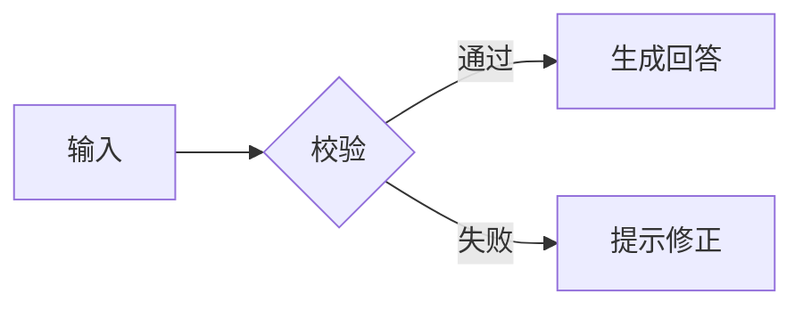

# Markdown 组件检查

这是一段普通文本，包含**粗体**、*斜体*、***粗斜体***、~~删除线~~、`行内代码`，以及 [外部链接](https://example.com)。


> 生成结果仍然需要人工复核。
>
> 支持多段引用与换行。

## 标题层级

### 三级标题

#### 四级标题

##### 五级标题

###### 六级标题

## 列表与任务

- 明确目标
  - 补充必要上下文
  - 说明输出格式
- 检查结果

1. 编写提示词
   1. 给出约束
   2. 提供示例
2. 复核输出

- [x] 明确目标
- [ ] 人工复核

## 表格与代码

| 能力 | 示例 | 覆盖 |
| :--- | :---: | ---: |
| 文本 | 摘要与问答 | ✅ |
| 代码 | 生成与解释 | ✅ |

```ts
const answer = 'Hello, Markdown';
console.log(answer);
```

未标注语言的代码块也会保留：

```
plain text
```

## 数学与流程图

行内公式 $E = mc^2$，块级公式：

$$
\sum_{i=1}^{n} i = \frac{n(n+1)}{2}
$$



---

以上组件应在浅色和深色主题下保持清晰。